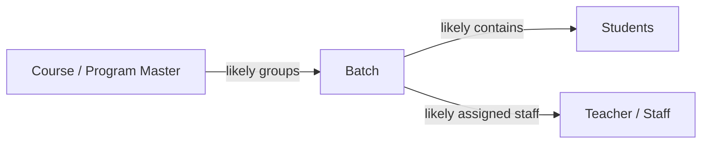
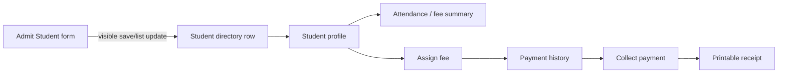
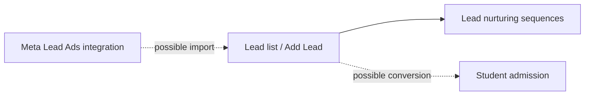
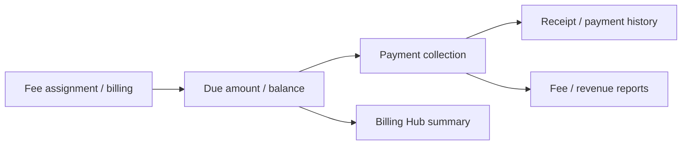
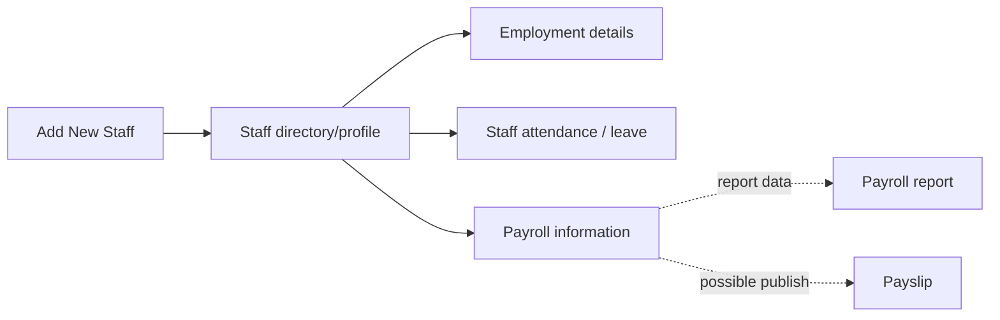
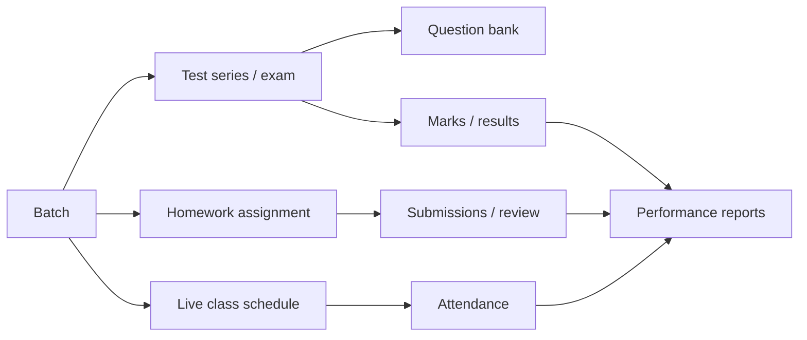
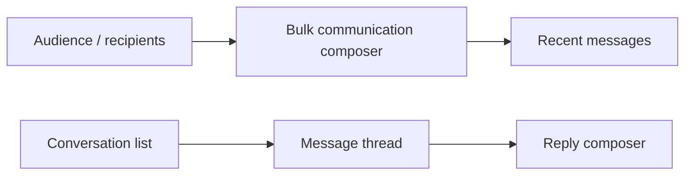

# CoachSutra Admin workflow map from video

This is an evidence map for the visible recording, not a recovered backend data model. `Observed` indicates screen sequence evidence. Relationships marked `inferred` should be confirmed before implementing a production schema.

## 1. Course/program and batch setup

- **Observed:** course/program page and add form around 00:24–01:18; batches page and create form around 01:24–03:06.
- **Inferred:** a batch belongs to a course and later groups students and assigned teacher(s). The video frames are too small to confirm exact foreign keys, multi-course behavior, capacity, or schedule rules.
- **Unverified:** save confirmation and downstream impact of course/batch creation.

## 2. Student admission and student record

- **Observed:** multi-section admission form at 03:12–06:06; success toast and directory count/row update at about 06:06–06:24; profile and fee/payment sequence at about 06:24–08:54.
- **Visible form groupings:** Personal Information, Academic Details, Parent/Guardian Details, and photo. Exact field labels, validation, duplicate checks and admission-number generation are not legible.
- **Observed relationship:** student detail context contains attendance and fees; fee assignment and payment history are reached from the student context.
- **Inferred:** student is linked to batch and fee assignments; payment applies to an assigned charge/installment; receipt represents a recorded payment.
- **Unknown:** whether a payment is online/offline, partial, refundable, reversible, or verified by a service; whether printed receipt is generated from stored data.

## 3. Leads and acquisition

- **Observed:** lead list at 09:54–11:06, Meta integration screen at 11:12–12:42, nurturing dashboard at 13:00–14:12.
- **Inferred:** external Meta leads may feed CRM records; a lead might later convert to an admitted student. Neither integration success nor conversion action is shown.
- **Unknown:** stage vocabulary, deduplication, consent/source attribution, sequence triggers, scheduling, opt-out, delivery logs and failure retry.

## 4. Billing, fee collection and reporting

- **Observed:** student fee assignment/payment sequence around 06:48–08:54; dashboard at 09:36; Smart Billing Hub at about 15:30; fee/revenue report cards at 23:36 onward.
- **Inferred:** billing and collection feed dashboard/reporting values. No formulas or direct transaction trace is available.
- **Unknown:** installments, discounts, waivers, tax, late fees, cash/bank/UPI/card methods, reconciliation, void/refund, receipts numbering, accounting period and report cutoff.

## 5. Staff and payroll

- **Observed:** Add New Staff form from 18:18; staff directory/profile from about 20:00; profile sections suggest employment, attendance/leave and payroll; payroll report category in report catalogue.
- **Inferred:** the staff profile likely serves as the identity for attendance and payroll records.
- **Unknown:** whether add-staff completes successfully, salary components, attendance deductions, approval, payroll period/locking, payment status, payslip generation, and bank transfer.

## 6. Academic delivery

- **Observed:** Live Class schedule form and list (16:18 and 27:42); PTM scheduling; Test Series list; exam mode selection/details/settings; Question Bank; Homework & Assignments; Attendance; reports.
- **Inferred:** assignments/exams/attendance are batch-related and contribute to student performance reporting. The footage does not show assignment publishing, submission review, exam attempt, grade entry, result release, live session join, or report drilldown.
- **Unknown:** subject/topic mapping, roster snapshots, grading scales, marks moderation, exam timing/proctoring, attendance correction rules and notification triggers.

## 7. Communication

- **Observed:** bulk composer and recent-message panel around 25:54–27:06; inbox/thread/reply controls around 27:12–27:36.
- **Inferred:** bulk and one-to-one communication may share delivery infrastructure, but the video does not prove this.
- **Unknown:** supported channel(s), actual recipient roles, opt-in/consent, send scheduling, delivery/read receipts, attachments, moderation, and retry behavior.

## 8. Dashboard metric lineage (inference only)

Visible dashboard cards/charts summarize student counts, enrollment trend and fee/revenue, while the report catalogue includes attendance, fee collection, performance, admissions, exams and payroll. Likely source record families are students/admissions, batches, attendance, assessment results, fee assignments/payments, staff and payroll. No visible evidence establishes exact computation, refresh cadence, date range, institute/branch boundaries, treatment of deleted/inactive records, or reconciliation with reports. Treat every displayed number in the video as demo data until validated against the product owner’s rules.

## Evidence and confidence ledger

| Claim | Basis | Confidence |
|---|---|---|
| Student admission has a visible save transition into the student list | Frame sequence 03:12–06:24 | Observed, medium (sampled video; no backend trace) |
| Fee collection is reached from a student/fee context and a receipt print view follows | Frame sequence about 06:48–08:54 | Observed sequence, medium; transaction semantics unknown |
| Course and batch are separate setup areas | Frames 00:24–03:06 | Observed, high |
| Student relates to batch/course | Labels and academic section, not fully legible | Inferred, low-to-medium |
| Fee assignment/payment impacts dashboard billing/report values | Separate screens only; no linked transaction trace | Inferred, low |
| Staff payroll is complete and payslips are issued here | No complete run/issue flow visible | Not established |
| Meta integration imports leads successfully | Setup page only | Not established |

No private source code, APIs, network traces or database were inspected.
